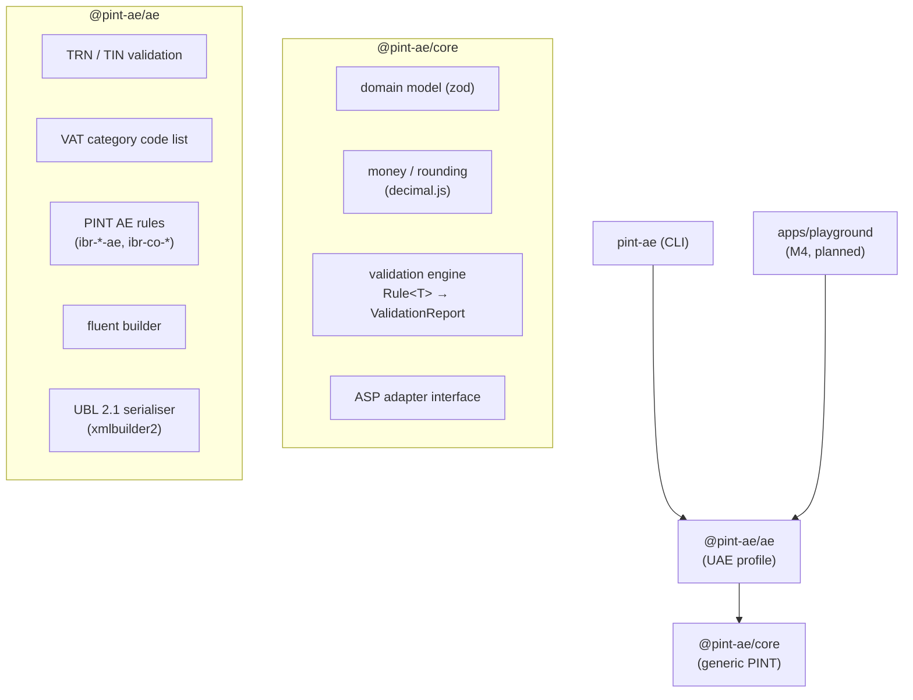
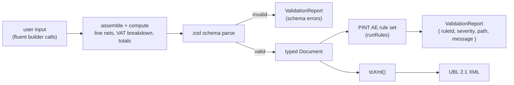

# Architecture

`pint-ae` is a pnpm-workspace monorepo. The design goal is a **generic Peppol
PINT core** with **pluggable country profiles**; the UAE (AE) profile is the
first, and later jurisdictions (SG, MY, JP, AU, EU) should slot in without
changing the core.

## Packages

- **`@pint-ae/core`** knows nothing about the UAE. It provides the typed model,
  exact-decimal money helpers, a tiny validation engine (`runRules` over
  `Rule<T>` producing a `ValidationReport`), and the `AspAdapter` interface.
- **`@pint-ae/ae`** supplies the UAE specifics: the official VAT category codes,
  TRN/TIN format checks, the business-rule set (each citing its Schematron rule
  ID), the builder and the UBL serialiser.
- **`pint-ae`** (CLI) and the future **playground** are thin front-ends over the
  profile package.

## Data flow

1. The builder collects seller/buyer/lines/etc.
2. On `build()` it computes the amounts the spec's calculation rules verify
   (line nets per `ibr-147-ae`, VAT breakdown, totals per `ibr-co-*`).
3. The assembled object is parsed by the zod schema; failures become a
   `ValidationReport` of `schema` messages.
4. A valid document is run through the PINT AE rule set.
5. `toXml()` serialises a document to PINT AE UBL 2.1.

Because the builder derives the amounts, the documents it produces pass the
calculation rules by construction; the rules exist to validate documents from
*any* source (notably, parsed external XML in Milestone 2).

## Money

Amounts never use JavaScript `number` arithmetic. They are stored in the model
as canonical decimal **strings** and manipulated with a configured `decimal.js`
clone (`ROUND_HALF_UP`, matching the XPath `round()` in the Schematron). See
[ADR 0003](./adr/0003-money-representation.md).

## Spec traceability

Every rule carries its official identifier (e.g. `ibr-132-ae`) and the verbatim
assertion text from the OpenPeppol PINT AE Billing Schematron. The source
artifacts and their checksums are recorded in
[`spec/SOURCES.md`](../spec/SOURCES.md). Nothing is invented; unknowns are left
as `TODO(spec)`.

## Testing

- Unit tests per module with Vitest; coverage thresholds ≥ 90% for `core` and
  `ae`.
- Each rule has at least one passing and one failing test.
- The workspace resolves `@pint-ae/core` to source during tests, so no build
  step is needed before `pnpm test`.
